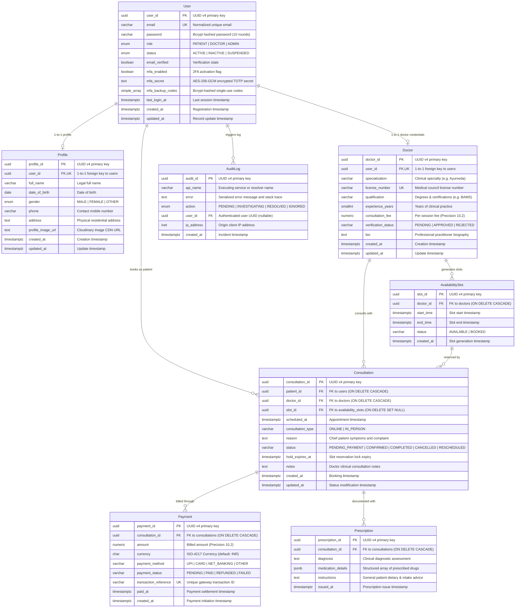
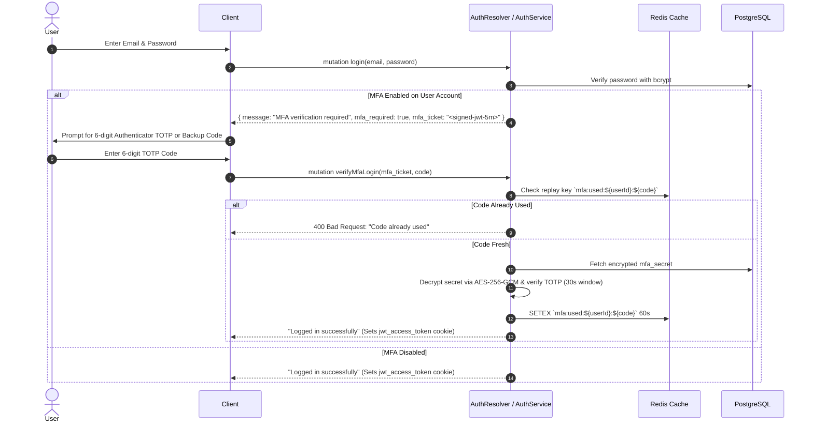
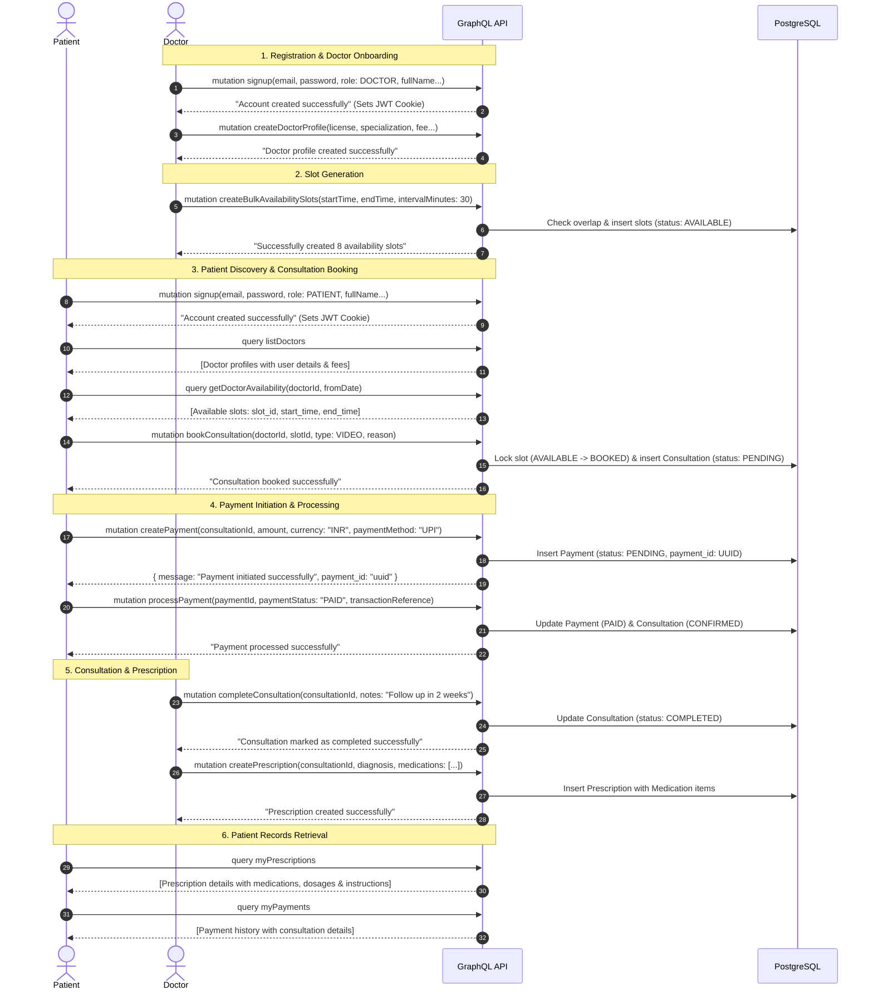

# Amrutam - Telemedicine & Doctor Booking GraphQL API

A robust, enterprise-grade Telemedicine and Doctor Consultation Backend built with **NestJS**, **GraphQL (Apollo Server Code-First)**, **TypeORM**, and **PostgreSQL**.

---

## 📑 Table of Contents

- [Overview](#overview)
- [Architecture & Tech Stack](#architecture--tech-stack)
- [Database Schema & Entity Relationship Diagram (ERD)](#database-schema--entity-relationship-diagram-erd)
  - [Entity Relationship Diagram](#entity-relationship-diagram)
  - [Entity Schema Definitions](#entity-schema-definitions)
- [Security Architecture & Zero-Trust Model](#security-architecture--zero-trust-model)
  - [1. Zero-Trust Access Pipeline](#1-zero-trust-access-pipeline)
  - [2. Dual-Mode Token Authentication](#2-dual-mode-token-authentication)
  - [3. Multi-Factor Authentication (MFA / 2FA) Deep Dive](#3-multi-factor-authentication-mfa--2fa-deep-dive)
  - [4. Concurrency Control & Double-Booking Prevention](#4-concurrency-control--double-booking-prevention)
  - [5. System Audit Logging & Incident Tracking](#5-system-audit-logging--incident-tracking)
- [Comprehensive User Flows & Lifecycle Diagrams](#comprehensive-user-flows--lifecycle-diagrams)
  - [Lifecycle Sequence Diagram](#lifecycle-sequence-diagram)
  - [Flow 1: User Onboarding, MFA Enrollment & 2-Step Login Handshake](#flow-1-user-onboarding-mfa-enrollment--2-step-login-handshake)
  - [Flow 2: Doctor Profile Setup & Availability Slot Generation](#flow-2-doctor-profile-setup--availability-slot-generation)
  - [Flow 3: Patient Discovery, Concurrency Locking & Consultation Booking](#flow-3-patient-discovery-concurrency-locking--consultation-booking)
  - [Flow 4: Payment Initiation & Processing](#flow-4-payment-initiation--processing)
  - [Flow 5: Consultation Execution & Digital Prescription Issuance](#flow-5-consultation-execution--digital-prescription-issuance)
  - [Flow 6: Admin Executive Analytics & Incident Audit](#flow-6-admin-executive-analytics--incident-audit)
- [GraphQL Operations Reference](#graphql-operations-reference)
  - [Auth & MFA Operations](#auth--mfa-operations)
  - [Profile Operations](#profile-operations)
  - [Doctor Operations](#doctor-operations)
  - [Availability Slot Operations](#availability-slot-operations)
  - [Consultation Operations](#consultation-operations)
  - [Payment Operations](#payment-operations)
  - [Prescription Operations](#prescription-operations)
  - [Audit Log Operations](#audit-log-operations)
  - [Admin Analytics Operations](#admin-analytics-operations)
- [Environment Configuration](#environment-configuration)
- [Getting Started](#getting-started)
- [Testing & Bruno Collection](#testing--bruno-collection)

---

## Overview

Amrutam API provides an end-to-end telemedicine backend platform connecting patients with verified medical specialists. Key capabilities include:

- **Role-Based Access Control (RBAC)**: Strict role guards for `PATIENT`, `DOCTOR`, and `ADMIN`.
- **UUID Primary & Foreign Keys**: Global UUID v4 identifiers across all domain entities.
- **Doctor Profile & Verification**: Specialized credentials, experience, license numbering, and consultation fees.
- **Availability Slot Engine**: Single slot creation and bulk slot generator with 30-minute intervals and collision prevention.
- **Consultation Lifecycle Management**: Slot reservation (`AVAILABLE` &rarr; `BOOKED`), status progression (`PENDING`, `CONFIRMED`, `COMPLETED`, `CANCELLED`, `RESCHEDULED`), notes, and slot release on cancellation.
- **Integrated Payment Flow**: Patient payment initiation returning a structured `CreatePaymentResponse` with `payment_id`, payment processing (`PENDING` &rarr; `PAID`), and full refund support.
- **Structured Digital Prescriptions**: Multi-item medication prescribing with dosage, frequency, duration, and patient instructions.
- **Audit Logging & Error Tracking**: Integrated logging in `handleServiceError` capturing failures and audit trails into PostgreSQL with admin queries and user activity inspection.
- **Clean GraphQL Contract**: Action mutations return lightweight confirmation strings (`String`) or structured response objects (e.g. `CreatePaymentResponse`), while queries deliver rich, deeply resolved entity graphs on demand.

---

## Architecture & Tech Stack

- **Framework**: [NestJS](https://nestjs.com/) (v12)
- **API Paradigm**: Code-First GraphQL via [@nestjs/graphql](https://docs.nestjs.com/graphql/quick-start) & [@nestjs/apollo](https://docs.nestjs.com/graphql/quick-start) (Apollo Server 4)
- **Database & ORM**: [TypeORM](https://typeorm.io/) with PostgreSQL (Supabase / local PostgreSQL)
- **Authentication**: JWT (JSON Web Tokens) with dual-mode support:
  - `Authorization: Bearer <token>` HTTP header
  - `jwt_access_token` HTTP-only, secure cookies
- **Security & Authorization**:
  - Global `PublicApiGuard` protecting all endpoints by default unless annotated with `@Public()`
  - `RolesGuard` enforcing role restrictions via `@Roles(...)` metadata
  - Parameter decorator `@CurrentUserId()` extracting authenticated subject UUIDs
  - `helmet`, `cors`, and `bcrypt` password hashing
- **Validation**: `class-validator` & `class-transformer` with global validation pipes
- **Runtime**: [Bun](https://bun.sh/) & Node.js (v20+)

---

## Database Schema & Entity Relationship Diagram (ERD)

The API is backed by PostgreSQL using TypeORM with global UUID v4 primary keys, strict foreign key constraints, and relational indexes.

### Entity Relationship Diagram



### Entity Schema Definitions

#### 1. `users` Table
Stores authentication identity credentials, role permissions, account lifecycle status, and multi-factor authentication security state.
- **Constraints**: `email` UNIQUE index.
- **Relationships**: `1:1` with `profiles`, `1:1` with `doctors`, `1:N` with `consultations` (as patient), `1:N` with `audit_logs`.

#### 2. `profiles` Table
Stores personal patient and doctor demographic details.
- **Constraints**: `user_id` UNIQUE foreign key referencing `users(user_id)` with `ON DELETE CASCADE`.

#### 3. `doctors` Table
Maintains medical licensure, clinical qualifications, specialization, verification review status, and consultation fees.
- **Constraints**: `user_id` UNIQUE foreign key, `license_number` UNIQUE.
- **Relationships**: `1:N` with `availability_slots` (`CASCADE`), `1:N` with `consultations` (`CASCADE`).

#### 4. `availability_slots` Table
Stores doctor appointment availability blocks.
- **Constraints**: Composite index on `(doctor_id, status)` for fast lookup during patient discovery.
- **Foreign Key**: `doctor_id` references `doctors(doctor_id)` with `CASCADE` on delete.

#### 5. `consultations` Table
Tracks patient-doctor appointment sessions through their complete state machine: `PENDING_PAYMENT` &rarr; `CONFIRMED` &rarr; `COMPLETED` (or `CANCELLED` / `RESCHEDULED`).
- **Foreign Keys**: `patient_id` references `users(user_id)`, `doctor_id` references `doctors(doctor_id)`, `slot_id` references `availability_slots(slot_id)` with `ON DELETE SET NULL`.
- **Hold Locks**: `hold_expires_at` tracks temporary slot holds during checkout.

#### 6. `payments` Table
Manages financial transactions, payment gateway references, payment methods, and settlement states (`PENDING`, `PAID`, `REFUNDED`).
- **Constraints**: `transaction_reference` UNIQUE.
- **Foreign Key**: `consultation_id` references `consultations(consultation_id)` with `CASCADE` on delete.

#### 7. `prescriptions` Table
Stores clinical diagnoses and digital medication charts issued by doctors.
- **Column `medication_details`**: PostgreSQL `JSONB` array of structured medication objects:
  ```json
  [
    {
      "name": "Ashwagandha Tablet",
      "dosage": "500mg",
      "frequency": "Twice daily",
      "duration": "30 days",
      "instructions": "Take after meals with warm milk"
    }
  ]
  ```

#### 8. `audit_logs` Table
Maintains security audit events, unhandled application exceptions, API error traces, and administrative resolution workflows (`PENDING`, `INVESTIGATING`, `RESOLVED`, `IGNORED`).

---

## Security Architecture & Zero-Trust Model

The platform enforces a Defense-in-Depth, Zero-Trust architectural design across every layer of the system.

```mermaid
graph TD
    Client[Client Request] --> Helmet[Helmet & CORS Middleware]
    Helmet --> PublicGuard{PublicApiGuard}
    PublicGuard -- "@Public()" --> Resolver[GraphQL Resolver Execution]
    PublicGuard -- Protected --> TokenExtract[Extract JWT from Cookie or Header]
    TokenExtract --> JWTVerify{Verify JWT Signature & Expiry}
    JWTVerify -- Invalid / Expired --> 401[401 Unauthorized]
    JWTVerify -- Valid --> UserStatusCheck{Check User Status}
    UserStatusCheck -- SUSPENDED / INACTIVE --> 403[403 Forbidden]
    UserStatusCheck -- ACTIVE --> RolesGuard{RolesGuard}
    RolesGuard -- Role Mismatch --> 403Role[403 Forbidden - Insufficient Permissions]
    RolesGuard -- Role Authorized --> Decorator[Inject @CurrentUserId()]
    Decorator --> Resolver
    Resolver --> Service[Service Layer with handleServiceError]
    Service -- Exception Caught --> AuditLog[(PostgreSQL audit_logs)]
```

### 1. Zero-Trust Access Pipeline

1. **Global `PublicApiGuard`**: Every GraphQL query and mutation is protected by default. Only operations decorated with `@Public()` (such as `signup`, `login`, and public doctor queries) bypass the authentication barrier.
2. **Account Status Verification**: Active sessions verify that `user.status === 'ACTIVE'`. Suspended or inactive accounts are rejected immediately before resolving domain data.
3. **`RolesGuard` Enforcement**: Evaluates role requirements specified via `@Roles(UserRole.DOCTOR, UserRole.ADMIN)`. Access is rejected with `ForbiddenException` if the authenticated user's role does not match.
4. **Context Identity Injection**: Resolvers access caller identity via `@CurrentUserId()` and `@CurrentUser()` decorators extracted directly from the verified token payload.

---

### 2. Dual-Mode Token Authentication

The API provides flexible, secure authentication across web browsers and mobile/native applications:

- **Web Clients (Zero-XSS Storage)**: The server automatically issues the `jwt_access_token` as an `HTTP-Only`, `Secure`, `SameSite=Lax` cookie. Web application JavaScript cannot read the token, mitigating Cross-Site Scripting (XSS) exfiltration attacks.
- **Mobile & Third-Party APIs**: Clients can supply the JWT via standard HTTP headers:
  ```http
  Authorization: Bearer <jwt_access_token>
  ```

---

### 3. Multi-Factor Authentication (MFA / 2FA) Deep Dive

Amrutam implements a high-security Two-Factor Authentication system based on Time-based One-Time Passwords (TOTP, RFC 6238) and Google Authenticator:



#### Key MFA Security Features:

1. **2-Step Login Ticket Handshake**:
   - When an MFA-enabled user logs in with email and password, the API does **not** grant access tokens.
   - Instead, it signs a temporary, short-lived `mfa_ticket` (5-minute TTL, `purpose: 'MFA_PENDING'`).
   - The user must call `verifyMfaLogin(input: { mfa_ticket, code })` to exchange the ticket for full access credentials.
2. **AES-256-GCM Authenticated Encryption at Rest**:
   - TOTP secrets are **never stored in plaintext**.
   - Before writing to PostgreSQL, secrets are encrypted using `aes-256-gcm` with random 16-byte initialization vectors (`IV`), authentication tags, and key derivation using `scryptSync` from `JWT_SECRET`.
3. **Redis Replay Attack Prevention**:
   - Each successfully validated 6-digit TOTP code is cached in Redis under `mfa:used:${userId}:${code}` for 60 seconds.
   - Attempting to replay the same TOTP within its 30-second window is rejected with a `400 Bad Request`.
4. **Bcrypt-Hashed Emergency Backup Recovery Codes**:
   - Upon enabling MFA, users receive 8 single-use emergency backup recovery codes (e.g. `a1b2c3d4`).
   - Backup codes are stored in PostgreSQL as `bcrypt` hashes (10 salt rounds).
   - Once a backup code is redeemed during `verifyMfaLogin`, it is atomically deleted from the user's account to prevent reuse.

---

### 4. Concurrency Control & Double-Booking Prevention

Telemedicine appointment booking requires strict concurrency guarantees to prevent two patients from reserving the same doctor slot simultaneously.

1. **Transactional Slot Status Transitions**:
   - Slots transition atomically: `AVAILABLE` &rarr; `BOOKED`.
   - When `bookConsultation` is called, the slot is locked inside a transactional unit of work. If the slot is already `BOOKED`, the transaction immediately aborts with `ConflictException('This slot has already been booked')`.
2. **Hold Reservation Expiry (`hold_expires_at`)**:
   - Initial bookings start in `PENDING_PAYMENT` with a configurable hold timestamp (e.g. 15 minutes).
   - If payment is not completed before hold expiration, scheduled jobs or booking queries release the slot back to `AVAILABLE`.
3. **Atomic Reschedule & Cancellation**:
   - Cancelling a consultation automatically marks the slot back to `AVAILABLE`.
   - Rescheduling atomically frees the old slot and reserves the new slot within a single transaction.

---

### 5. System Audit Logging & Incident Tracking

The API integrates real-time error auditing directly into `handleServiceError`:
- **Automated Capture**: Any unhandled internal server error automatically logs the error message, execution stack, calling service name, user ID, and client IP address into the `audit_logs` table.
- **Incident Lifecycle**: Admins can query audit logs by API name, user, or status, and update the investigation lifecycle (`PENDING` &rarr; `INVESTIGATING` &rarr; `RESOLVED` / `IGNORED`).

---

## Comprehensive User Flows & Lifecycle Diagrams

### Lifecycle Sequence Diagram



---

### Step-by-Step Flow Walkthrough

#### 1. User Onboarding & Authentication
Both Patients and Doctors create accounts via the `signup` mutation. The API sets a secure HTTP-only `jwt_access_token` cookie and returns a confirmation message.

**Doctor Signup Request:**
```graphql
mutation DoctorSignup($input: SignupDto!) {
  signup(input: $input)
}
```
*Variables:*
```json
{
  "input": {
    "email": "doctor@amrutam.co.in",
    "password": "Password@123",
    "role": "DOCTOR",
    "full_name": "Dr. Sarah Jenkins",
    "phone": "+919876543210",
    "gender": "FEMALE",
    "date_of_birth": "1988-05-14T00:00:00.000Z"
  }
}
```

**Patient Signup Request:**
```graphql
mutation PatientSignup($input: SignupDto!) {
  signup(input: $input)
}
```
*Variables:*
```json
{
  "input": {
    "email": "patient@amrutam.co.in",
    "password": "Password@123",
    "role": "PATIENT",
    "full_name": "John Doe",
    "phone": "+919811122233",
    "gender": "MALE",
    "date_of_birth": "1995-08-20T00:00:00.000Z"
  }
}
```

---

#### 2. Doctor Profile & Availability Slot Creation
Once logged in, a doctor creates their medical profile and generates booking slots for patients.

**Create Doctor Profile:**
```graphql
mutation CreateDoctorProfile($input: CreateDoctorDto!) {
  createDoctorProfile(input: $input)
}
```
*Variables:*
```json
{
  "input": {
    "license_number": "MCI-2026-98745",
    "specialization": "Ayurveda & Holistic Medicine",
    "experience_years": 12,
    "consultation_fee": "750.00",
    "bio": "Specializing in chronic care and Panchakarma therapies."
  }
}
```

**Bulk Create Availability Slots:**
```graphql
mutation BulkCreateSlots($input: BulkCreateSlotsDto!) {
  createBulkAvailabilitySlots(input: $input)
}
```
*Variables:*
```json
{
  "input": {
    "start_time": "2026-11-01T09:00:00.000Z",
    "end_time": "2026-11-01T13:00:00.000Z",
    "interval_minutes": 30
  }
}
```
*Response:* `"Successfully created 8 availability slots"`

---

#### 3. Discovery & Consultation Booking
Patients discover doctors and inspect open slots without requiring authentication (`@Public()`), then book an appointment using their authenticated session.

**List Verified Doctors:**
```graphql
query ListDoctors {
  listDoctors {
    doctor_id
    specialization
    experience_years
    consultation_fee
    user {
      profile {
        full_name
      }
    }
  }
}
```

**View Doctor's Open Slots:**
```graphql
query GetDoctorAvailability($doctorId: ID!, $fromDate: DateTime) {
  getDoctorAvailability(doctorId: $doctorId, fromDate: $fromDate) {
    slot_id
    start_time
    end_time
    status
  }
}
```

**Book Consultation (Patient):**
```graphql
mutation BookConsultation($input: CreateConsultationDto!) {
  bookConsultation(input: $input)
}
```
*Variables:*
```json
{
  "input": {
    "doctor_id": "c1f7a0b2-3e4d-5c6f-7a8b-9c0d1e2f3a4b",
    "slot_id": "d2e8b1c3-4f5a-6b7c-8d9e-0f1a2b3c4d5e",
    "consultation_type": "VIDEO",
    "reason": "Persistent digestive fatigue and dietary consultation"
  }
}
```
*Result:* Slot status transitions to `BOOKED`, consultation is recorded as `PENDING`.

---

#### 4. Payment Initiation & Processing
The patient initiates a payment for the consultation. The mutation returns both a confirmation message and the newly created `payment_id`.

**Initiate Payment:**
```graphql
mutation CreatePayment($input: CreatePaymentDto!) {
  createPayment(input: $input) {
    message
    payment_id
  }
}
```
*Variables:*
```json
{
  "input": {
    "consultation_id": "e3f9c2d4-5a6b-7c8d-9e0f-1a2b3c4d5e6f",
    "amount": "750.00",
    "currency": "INR",
    "payment_method": "UPI",
    "transaction_reference": "TXN_UPI_9876543210"
  }
}
```
*Response:*
```json
{
  "data": {
    "createPayment": {
      "message": "Payment initiated successfully",
      "payment_id": "f4a0d3e5-6b7c-8d9e-0f1a-2b3c4d5e6f7a"
    }
  }
}
```

**Process Payment (Mark as Paid):**
```graphql
mutation ProcessPayment($input: ProcessPaymentDto!) {
  processPayment(input: $input)
}
```
*Variables:*
```json
{
  "input": {
    "payment_id": "f4a0d3e5-6b7c-8d9e-0f1a-2b3c4d5e6f7a",
    "payment_status": "PAID",
    "payment_method": "UPI",
    "transaction_reference": "TXN_UPI_9876543210"
  }
}
```
*Result:* Payment status is updated to `PAID`, `paid_at` timestamp is set, and the linked consultation is confirmed.

---

#### 5. Consultation Execution & Digital Prescription
The doctor completes the consultation session and issues a digital prescription with medication instructions.

**Complete Consultation (Doctor):**
```graphql
mutation CompleteConsultation($consultationId: ID!, $notes: String) {
  completeConsultation(consultationId: $consultationId, notes: $notes)
}
```
*Variables:*
```json
{
  "consultationId": "e3f9c2d4-5a6b-7c8d-9e0f-1a2b3c4d5e6f",
  "notes": "Patient advised dietary modifications, herbal supplements, and regular hydration."
}
```

**Create Digital Prescription (Doctor):**
```graphql
mutation CreatePrescription($input: CreatePrescriptionDto!) {
  createPrescription(input: $input)
}
```
*Variables:*
```json
{
  "input": {
    "consultation_id": "e3f9c2d4-5a6b-7c8d-9e0f-1a2b3c4d5e6f",
    "diagnosis": "Agnimandya (Digestive Weakness)",
    "notes": "Take all medications after meals with warm water.",
    "medications": [
      {
        "name": "Triphala Churna",
        "dosage": "5g",
        "frequency": "Twice daily",
        "duration": "14 days",
        "instructions": "Consume with warm water before bedtime"
      },
      {
        "name": "Trikatu Syrup",
        "dosage": "10ml",
        "frequency": "Once daily",
        "duration": "10 days",
        "instructions": "Take 30 minutes after lunch"
      }
    ]
  }
}
```

**Patient Retrieves Prescriptions:**
```graphql
query MyPrescriptions {
  myPrescriptions {
    prescription_id
    diagnosis
    notes
    medications {
      name
      dosage
      frequency
      duration
      instructions
    }
    created_at
  }
}
```

---

## GraphQL Operations Reference

All GraphQL queries and mutations are served at `/graphql`.

### Auth Operations

| Type | Operation | Access | Description |
|---|---|---|---|
| `Mutation` | `signup(input: SignupDto!): String!` | `@Public()` | Creates user credentials and profile; sets JWT cookie; returns confirmation. |
| `Mutation` | `login(input: LoginDto!): String!` | `@Public()` | Validates credentials; sets JWT cookie; returns confirmation. |
| `Mutation` | `logout: String!` | `@Public()` | Clears `jwt_access_token` authentication cookie. |
| `Query` | `me: UserEntity!` | Protected | Retrieves authenticated user account and nested profile. |

---

### Doctor Operations

| Type | Operation | Access | Description |
|---|---|---|---|
| `Mutation` | `createDoctorProfile(input: CreateDoctorDto!): String!` | `DOCTOR` | Registers medical license, specialization, experience, and fee. |
| `Mutation` | `updateDoctorProfile(input: UpdateDoctorDto!): String!` | `DOCTOR` | Updates existing doctor profile details. |
| `Query` | `myDoctorProfile: DoctorEntity!` | `DOCTOR` | Retrieves the profile for the currently authenticated doctor. |
| `Query` | `getDoctorById(doctorId: ID!): DoctorEntity!` | `@Public()` | Retrieves public doctor details by doctor UUID. |
| `Query` | `listDoctors: [DoctorEntity!]!` | `@Public()` | Retrieves all verified registered doctors. |

---

### Availability Slot Operations

| Type | Operation | Access | Description |
|---|---|---|---|
| `Mutation` | `createAvailabilitySlot(input: CreateAvailabilitySlotDto!): String!` | `DOCTOR` | Adds a single availability slot for the doctor. |
| `Mutation` | `createBulkAvailabilitySlots(input: BulkCreateSlotsDto!): String!` | `DOCTOR` | Generates consecutive slots split by interval minutes. |
| `Mutation` | `updateAvailabilitySlot(slotId: ID!, input: UpdateAvailabilitySlotDto!): String!` | `DOCTOR` | Updates slot timing or status (`AVAILABLE`, `LOCKED`, etc.). |
| `Mutation` | `deleteAvailabilitySlot(slotId: ID!): String!` | `DOCTOR` | Deletes an unbooked slot. |
| `Query` | `getDoctorAvailability(doctorId: ID!, fromDate: DateTime): [AvailabilitySlotEntity!]!` | `@Public()` | Retrieves upcoming available slots for a doctor. |
| `Query` | `myAvailabilitySlots: [AvailabilitySlotEntity!]!` | `DOCTOR` | Lists all slots owned by the authenticated doctor. |
| `Query` | `getAvailabilitySlotById(slotId: ID!): AvailabilitySlotEntity!` | Protected | Retrieves a specific slot by UUID. |

---

### Consultation Operations

| Type | Operation | Access | Description |
|---|---|---|---|
| `Mutation` | `bookConsultation(input: CreateConsultationDto!): String!` | `PATIENT` | Reserves an available slot and creates a consultation record. |
| `Mutation` | `rescheduleConsultation(input: RescheduleConsultationDto!): String!` | Protected | Swaps consultation to a new slot and releases the previous one. |
| `Mutation` | `cancelConsultation(consultationId: ID!, reason: String): String!` | Protected | Cancels consultation and restores slot status to `AVAILABLE`. |
| `Mutation` | `completeConsultation(consultationId: ID!, notes: String): String!` | `DOCTOR` | Marks consultation as `COMPLETED` and saves clinical notes. |
| `Query` | `getConsultationById(consultationId: ID!): ConsultationEntity!` | Protected | Retrieves detailed consultation data by ID. |
| `Query` | `myConsultations: [ConsultationEntity!]!` | Protected | Lists all consultations where user is patient or doctor. |

---

### Payment Operations

| Type | Operation | Access | Description |
|---|---|---|---|
| `Mutation` | `createPayment(input: CreatePaymentDto!): CreatePaymentResponse!` | `PATIENT` | Initiates a payment; returns `message` and `payment_id`. |
| `Mutation` | `processPayment(input: ProcessPaymentDto!): String!` | `PATIENT`, `DOCTOR`, `ADMIN` | Updates transaction status (e.g. `PAID`, `FAILED`). |
| `Mutation` | `refundPayment(paymentId: ID!): String!` | `PATIENT`, `DOCTOR`, `ADMIN` | Refunds a completed payment record. |
| `Query` | `getPaymentById(paymentId: ID!): PaymentEntity!` | `PATIENT`, `DOCTOR`, `ADMIN` | Fetches payment details and linked consultation. |
| `Query` | `getPaymentsByConsultation(consultationId: ID!): [PaymentEntity!]!` | `PATIENT`, `DOCTOR`, `ADMIN` | Fetches all payment records for a consultation. |
| `Query` | `myPayments: [PaymentEntity!]!` | `PATIENT`, `DOCTOR`, `ADMIN` | Returns all payment transactions involving the user. |

---

### Prescription Operations

| Type | Operation | Access | Description |
|---|---|---|---|
| `Mutation` | `createPrescription(input: CreatePrescriptionDto!): String!` | `DOCTOR` | Issues a digital prescription with medication array. |
| `Mutation` | `updatePrescription(prescriptionId: ID!, input: UpdatePrescriptionDto!): String!` | `DOCTOR` | Modifies prescription diagnosis, notes, or medications. |
| `Query` | `getPrescriptionById(prescriptionId: ID!): PrescriptionEntity!` | `@Public()` | Retrieves a single prescription by UUID. |
| `Query` | `getPrescriptionsByConsultation(consultationId: ID!): [PrescriptionEntity!]!` | `DOCTOR`, `PATIENT` | Retrieves prescriptions for a specific consultation. |
| `Query` | `myPrescriptions: [PrescriptionEntity!]!` | `DOCTOR`, `PATIENT` | Lists all prescriptions relevant to current patient or doctor. |

---

### Audit Log Operations

| Type | Operation | Access | Description |
|---|---|---|---|
| `Mutation` | `recordAuditLog(input: CreateAuditLogDto!): String!` | `ADMIN` | Manually writes an audit log entry. |
| `Mutation` | `updateAuditLogAction(auditId: ID!, action: AuditLogAction!): String!` | `ADMIN` | Updates log action status (`PENDING`, `PROCESS`, `FIXED`). |
| `Query` | `getAuditLogs(action: AuditLogAction, limit: Int, offset: Int): [AuditLogEntity!]!` | `ADMIN` | Retrieves paginated system audit & error logs. |
| `Query` | `getAuditLogById(auditId: ID!): AuditLogEntity!` | `ADMIN` | Fetches a single audit log by UUID. |
| `Query` | `getAuditLogsByApi(apiName: String!, limit: Int, offset: Int): [AuditLogEntity!]!` | `ADMIN` | Retrieves audit logs filtered by API name. |
| `Query` | `getAuditLogsByUser(userId: ID!, limit: Int, offset: Int): [AuditLogEntity!]!` | `ADMIN` | Retrieves audit logs for a specific user ID. |

```graphql
# Example: Query System Audit & Error Logs (Admin)
query GetAuditLogs($action: AuditLogAction, $limit: Int, $offset: Int) {
  getAuditLogs(action: $action, limit: $limit, offset: $offset) {
    audit_id
    api_name
    error
    action
    user_id
    ip_address
    created_at
  }
}
```

---

### Admin Analytics Operations

| Type | Operation | Access | Description |
|---|---|---|---|
| `Query` | `adminDashboardSummary(filter: AnalyticsFilterInput): AdminDashboardSummaryEntity!` | `ADMIN` | Top-level KPI overview (revenue, growth %, consults, doctors, patients, slot utilization, active users). |
| `Query` | `adminRevenueAnalytics(filter: AnalyticsFilterInput): RevenueAnalyticsEntity!` | `ADMIN` | In-depth settled revenue time-series, payment methods, transaction values, and payment status breakdown. |
| `Query` | `adminConsultationAnalytics(filter: AnalyticsFilterInput): ConsultationAnalyticsEntity!` | `ADMIN` | Appointment volume timeline, completion/cancellation rates, status distribution, and peak hours. |
| `Query` | `adminDoctorAnalytics(filter: AnalyticsFilterInput): DoctorAnalyticsEntity!` | `ADMIN` | Doctor verification queue, specialization breakdown, slot capacity metrics, and top 10 doctor performers. |
| `Query` | `adminPatientAnalytics(filter: AnalyticsFilterInput): PatientAnalyticsEntity!` | `ADMIN` | Patient growth trends, repeat consultation cohorts, retention rate, and gender demographic distribution. |
| `Query` | `adminClinicalAndSystemAnalytics(filter: AnalyticsFilterInput): ClinicalAndSystemAnalyticsEntity!` | `ADMIN` | Digital prescription rate, top diagnosed conditions, audit error rates, and top failing API services. |

```graphql
# Example: Query Executive Dashboard Summary
query AdminDashboardSummary($filter: AnalyticsFilterInput) {
  adminDashboardSummary(filter: $filter) {
    total_revenue
    revenue_growth_percentage
    total_consultations
    completed_consultations
    cancellation_rate
    total_patients
    new_patients_in_period
    total_doctors
    pending_doctor_verifications
    slot_utilization_rate
    active_users_last_30_days
  }
}
```

---

## Authentication & Role-Based Access Control

The API employs a zero-trust security model:

1. **Global `PublicApiGuard`**: Every GraphQL resolver is protected by default. Only operations decorated with `@Public()` allow unauthenticated access.
2. **`RolesGuard`**: Evaluates user roles against `@Roles(...)` metadata. Supports single or multiple authorized roles (e.g. `@Roles(UserRole.DOCTOR, UserRole.PATIENT)`).
3. **Dual Token Delivery**:
   - Web browsers automatically send the HTTP-only `jwt_access_token` cookie.
   - Mobile and API clients can send `Authorization: Bearer <token>`.
4. **`@CurrentUserId()`**: Resolvers extract the authenticated user UUID directly from context, eliminating repetitive credential validation logic.

---

## Environment Configuration

Create or update `.env` in the `api` root directory:

```env
# Server
PORT=8000
NODE_ENV=development
GRAPHQL_PLAYGROUND=true

# Database (PostgreSQL / Supabase)
DATABASE_URL=postgresql://<username>:<password>@<host>:5432/<database>
DATABASE_SSL=true

# Redis (set REDIS_URL or REDIS_HOST/REDIS_PORT; password is optional)
REDIS_HOST=localhost
REDIS_PORT=6379
# REDIS_PASSWORD=your-redis-password

# Authentication
JWT_SECRET=super-secure-jwt-secret-key-min-32-chars
JWT_EXPIRES_IN=7d
JWT_COOKIE_NAME=jwt_access_token
JWT_COOKIE_MAX_AGE=604800000
BCRYPT_SALT_ROUNDS=10

# NestJS Observability (APM & Distributed Tracing)
OBSERVE_SERVICE_ID=amrutam-api
OBSERVE_APP_KEY=your-observe-app-key
OBSERVE_APP_SECRET=your-observe-app-secret
```

---

## Getting Started

### Prerequisites
- [Bun](https://bun.sh/) (recommended) or [Node.js](https://nodejs.org/) (v20+)
- PostgreSQL 14+ instance

### 1. Install Dependencies
```bash
bun install
# or
npm install
```

### 2. Run the Development Server
```bash
bun run start:dev
# or
npm run start:dev
```

The Apollo GraphQL Sandbox / Playground will be accessible at:  
`http://localhost:8000/graphql`

### 3. Production Build
```bash
bun run build
bun run start:prod
```

### 4. Test Redis Queue and Concurrency
With Redis running and the Redis environment variables configured, run:
```bash
bun run test:redis
# or
npm run test:redis
```

The script checks Redis connectivity, FIFO processing with simulated concurrent
workers, and atomic slot locking under concurrent requests. It uses temporary,
unique Redis keys and removes them after the test. This is a Redis smoke test;
the API does not currently configure a production job-queue library.

### 5. Deploying the Docker API to Render for Free

This repository includes a Render Blueprint (`render.yaml`) and a GitHub Actions
workflow. Render builds and runs the Docker image directly from this GitHub
repository; a separate Docker registry is not required.

1. Push or merge the changes to the `main` branch on GitHub.
2. In Render, create a **Blueprint** and connect this repository. Confirm the
   `amrutam-api` web service from `render.yaml`.
3. Set the requested `DATABASE_URL` and `JWT_SECRET` values in Render. Use a
   PostgreSQL connection URL and a strong, unique JWT secret. Configure
   `REDIS_URL` if using a hosted Redis instance.
4. In the Render service settings, create a deploy hook. Add its URL to the
   GitHub repository as an Actions secret named `RENDER_DEPLOY_HOOK`
   (**Settings → Secrets and variables → Actions**).
5. Push to `main` (or run the workflow manually). GitHub Actions builds the
   Docker image first and triggers Render only after the build succeeds.

The `/health` endpoint is used for Render health checks. Render's free web
services can spin down when idle and may have other plan limits; availability
and included free resources depend on Render's current plan. The API also needs
an externally reachable PostgreSQL database, and Redis is optional.

### 6. Deploying NestJS to Vercel

Vercel supports NestJS as a serverless function. This deployment does not run
the Docker container.

1. Create a Vercel project and import this GitHub repository. Set the Vercel
   project **Root Directory** to `api`.
2. In Vercel project settings, add the runtime environment variables required
   by the API, including `DATABASE_URL` and a strong, unique `JWT_SECRET`.
   Configure `DATABASE_SSL`, `REDIS_URL`, and other values as needed.
3. In the Vercel dashboard, copy the account/team ID and project ID. Create a
   Vercel access token.
4. Add these GitHub Actions repository secrets under **Settings → Secrets and
   variables → Actions**: `VERCEL_ORG_ID`, `VERCEL_PROJECT_ID`, and
   `VERCEL_TOKEN`.
5. Disable Vercel's automatic Git deployments if you want GitHub Actions to
   gate production deploys; otherwise, Vercel may also deploy the same push
   independently.
6. Push or merge changes to `main`. The workflow builds the NestJS application
   and deploys to Vercel only after the build succeeds. Pull requests to `main`
   run the build check without deploying.

Serverless deployments have platform limits and are not a persistent Docker
container.

### 7. Running with Docker & Docker Compose

#### Using Docker Compose (API + PostgreSQL):
```bash
docker compose up --build -d
```
The API will be available at `http://localhost:8000/graphql` and PostgreSQL at `localhost:5432`.

#### Building and Running the Docker Image directly:
```bash
# Build the production image
docker build -t amrutam-api .

# Run container with environment configuration
docker run -p 8000:8000 --env-file .env amrutam-api
```

---

## Testing & Bruno Collection

A full suite of pre-configured [Bruno](https://usebruno.com/) API collections is available under `api/.bruno/`:

- `.bruno/auth/`
  - `doctor-signup.bru`, `patient-signup.bru`, `admin-signup.bru`
  - `login.bru`, `logout.bru`, `me.bru`
- `.bruno/doctor/`
  - `create-doctor-profile.bru`, `update-doctor-profile.bru`, `my-doctor-profile.bru`, `get-doctor-by-id.bru`, `list-doctors.bru`
- `.bruno/availability-slot/`
  - `create-availability-slot.bru`, `bulk-create-availability-slots.bru`, `update-availability-slot.bru`, `delete-availability-slot.bru`, `get-doctor-availability.bru`, `my-availability-slots.bru`, `get-availability-slot-by-id.bru`
- `.bruno/consultation/`
  - `book-consultation.bru`, `reschedule-consultation.bru`, `cancel-consultation.bru`, `complete-consultation.bru`, `get-consultation-by-id.bru`, `my-consultations.bru`
- `.bruno/payment/`
  - `create-payment.bru`, `process-payment.bru`, `refund-payment.bru`, `get-payment-by-id.bru`, `get-payments-by-consultation.bru`, `my-payments.bru`
- `.bruno/prescription/`
  - `create-prescription.bru`, `update-prescription.bru`, `get-prescription-by-id.bru`, `get-prescriptions-by-consultation.bru`, `my-prescriptions.bru`
- `.bruno/audit-log/`
  - `get-audit-logs.bru`, `get-audit-log-by-id.bru`, `get-audit-logs-by-api.bru`, `get-audit-logs-by-user.bru`, `update-audit-log-action.bru`, `record-audit-log.bru`
