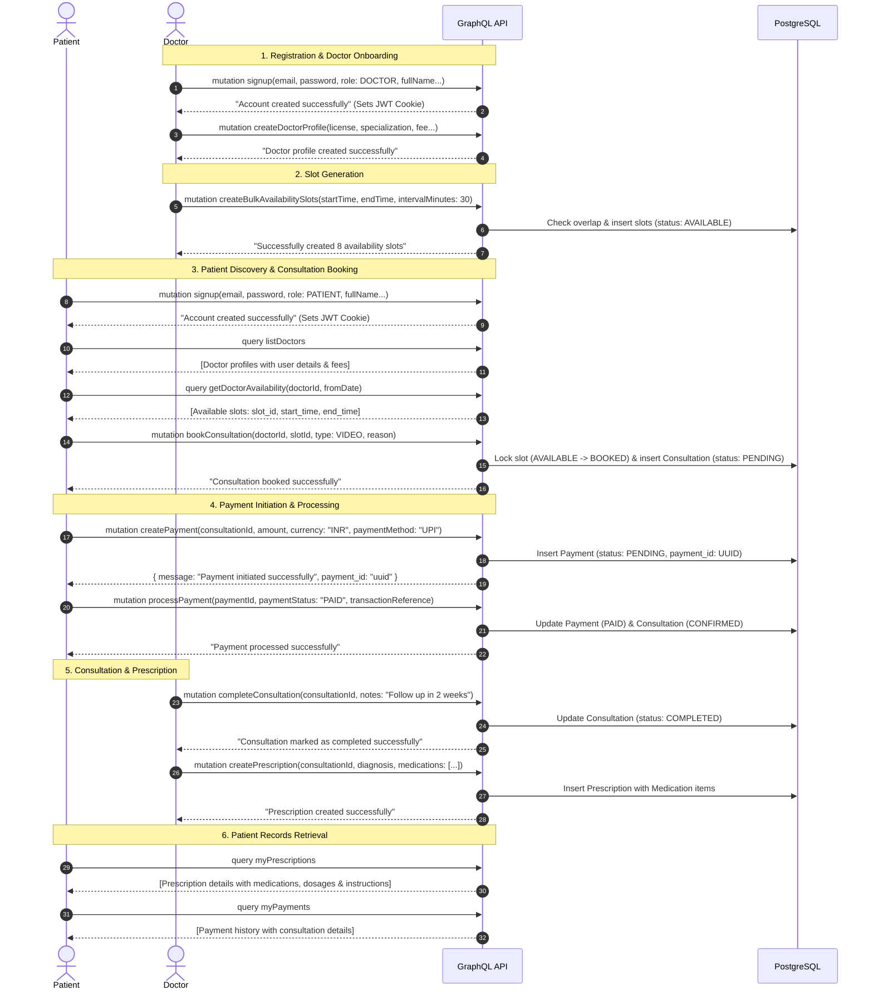

# Amrutam - Telemedicine & Doctor Booking GraphQL API

A robust, enterprise-grade Telemedicine and Doctor Consultation Backend built with **NestJS**, **GraphQL (Apollo Server Code-First)**, **TypeORM**, and **PostgreSQL**.

---

## 📑 Table of Contents

- [Overview](#overview)
- [Architecture & Tech Stack](#architecture--tech-stack)
- [End-to-End API Flow](#end-to-end-api-flow)
  - [Lifecycle Sequence Diagram](#lifecycle-sequence-diagram)
  - [Step-by-Step Flow Walkthrough](#step-by-step-flow-walkthrough)
    - [1. User Onboarding & Authentication](#1-user-onboarding--authentication)
    - [2. Doctor Profile & Availability Slot Creation](#2-doctor-profile--availability-slot-creation)
    - [3. Discovery & Consultation Booking](#3-discovery--consultation-booking)
    - [4. Payment Initiation & Processing](#4-payment-initiation--processing)
    - [5. Consultation Execution & Digital Prescription](#5-consultation-execution--digital-prescription)
- [GraphQL Operations Reference](#graphql-operations-reference)
  - [Auth Operations](#auth-operations)
  - [Doctor Operations](#doctor-operations)
  - [Availability Slot Operations](#availability-slot-operations)
  - [Consultation Operations](#consultation-operations)
  - [Payment Operations](#payment-operations)
  - [Prescription Operations](#prescription-operations)
  - [Audit Log Operations](#audit-log-operations)
- [Authentication & Role-Based Access Control](#authentication--role-based-access-control)
- [Environment Configuration](#environment-configuration)
- [Getting Started](#getting-started)
- [Testing & Bruno Collection](#testing--bruno-collection)

---

## Overview

Amrutam API provides an end-to-end telemedicine backend platform connecting patients with verified medical specialists. Key capabilities include:

- **Role-Based Access Control (RBAC)**: Strict role guards for `PATIENT`, `DOCTOR`, and `ADMIN`.
- **UUID Primary & Foreign Keys**: Global UUID v4 identifiers across all domain entities.
- **Doctor Profile & Verification**: Specialized credentials, experience, license numbering, and consultation fees.
- **Availability Slot Engine**: Single slot creation and bulk slot generator with 30-minute intervals and collision prevention.
- **Consultation Lifecycle Management**: Slot reservation (`AVAILABLE` &rarr; `BOOKED`), status progression (`PENDING`, `CONFIRMED`, `COMPLETED`, `CANCELLED`, `RESCHEDULED`), notes, and slot release on cancellation.
- **Integrated Payment Flow**: Patient payment initiation returning a structured `CreatePaymentResponse` with `payment_id`, payment processing (`PENDING` &rarr; `PAID`), and full refund support.
- **Structured Digital Prescriptions**: Multi-item medication prescribing with dosage, frequency, duration, and patient instructions.
- **Audit Logging & Error Tracking**: Integrated logging in `handleServiceError` capturing failures and audit trails into PostgreSQL with admin queries and user activity inspection.
- **Clean GraphQL Contract**: Action mutations return lightweight confirmation strings (`String`) or structured response objects (e.g. `CreatePaymentResponse`), while queries deliver rich, deeply resolved entity graphs on demand.

---

## Architecture & Tech Stack

- **Framework**: [NestJS](https://nestjs.com/) (v12)
- **API Paradigm**: Code-First GraphQL via [@nestjs/graphql](https://docs.nestjs.com/graphql/quick-start) & [@nestjs/apollo](https://docs.nestjs.com/graphql/quick-start) (Apollo Server 4)
- **Database & ORM**: [TypeORM](https://typeorm.io/) with PostgreSQL (Supabase / local PostgreSQL)
- **Authentication**: JWT (JSON Web Tokens) with dual-mode support:
  - `Authorization: Bearer <token>` HTTP header
  - `jwt_access_token` HTTP-only, secure cookies
- **Security & Authorization**:
  - Global `PublicApiGuard` protecting all endpoints by default unless annotated with `@Public()`
  - `RolesGuard` enforcing role restrictions via `@Roles(...)` metadata
  - Parameter decorator `@CurrentUserId()` extracting authenticated subject UUIDs
  - `helmet`, `cors`, and `bcrypt` password hashing
- **Validation**: `class-validator` & `class-transformer` with global validation pipes
- **Runtime**: [Bun](https://bun.sh/) & Node.js (v20+)

---

## End-to-End API Flow

### Lifecycle Sequence Diagram



---

### Step-by-Step Flow Walkthrough

#### 1. User Onboarding & Authentication
Both Patients and Doctors create accounts via the `signup` mutation. The API sets a secure HTTP-only `jwt_access_token` cookie and returns a confirmation message.

**Doctor Signup Request:**
```graphql
mutation DoctorSignup($input: SignupDto!) {
  signup(input: $input)
}
```
*Variables:*
```json
{
  "input": {
    "email": "doctor@amrutam.co.in",
    "password": "Password@123",
    "role": "DOCTOR",
    "full_name": "Dr. Sarah Jenkins",
    "phone": "+919876543210",
    "gender": "FEMALE",
    "date_of_birth": "1988-05-14T00:00:00.000Z"
  }
}
```

**Patient Signup Request:**
```graphql
mutation PatientSignup($input: SignupDto!) {
  signup(input: $input)
}
```
*Variables:*
```json
{
  "input": {
    "email": "patient@amrutam.co.in",
    "password": "Password@123",
    "role": "PATIENT",
    "full_name": "John Doe",
    "phone": "+919811122233",
    "gender": "MALE",
    "date_of_birth": "1995-08-20T00:00:00.000Z"
  }
}
```

---

#### 2. Doctor Profile & Availability Slot Creation
Once logged in, a doctor creates their medical profile and generates booking slots for patients.

**Create Doctor Profile:**
```graphql
mutation CreateDoctorProfile($input: CreateDoctorDto!) {
  createDoctorProfile(input: $input)
}
```
*Variables:*
```json
{
  "input": {
    "license_number": "MCI-2026-98745",
    "specialization": "Ayurveda & Holistic Medicine",
    "experience_years": 12,
    "consultation_fee": "750.00",
    "bio": "Specializing in chronic care and Panchakarma therapies."
  }
}
```

**Bulk Create Availability Slots:**
```graphql
mutation BulkCreateSlots($input: BulkCreateSlotsDto!) {
  createBulkAvailabilitySlots(input: $input)
}
```
*Variables:*
```json
{
  "input": {
    "start_time": "2026-11-01T09:00:00.000Z",
    "end_time": "2026-11-01T13:00:00.000Z",
    "interval_minutes": 30
  }
}
```
*Response:* `"Successfully created 8 availability slots"`

---

#### 3. Discovery & Consultation Booking
Patients discover doctors and inspect open slots without requiring authentication (`@Public()`), then book an appointment using their authenticated session.

**List Verified Doctors:**
```graphql
query ListDoctors {
  listDoctors {
    doctor_id
    specialization
    experience_years
    consultation_fee
    user {
      profile {
        full_name
      }
    }
  }
}
```

**View Doctor's Open Slots:**
```graphql
query GetDoctorAvailability($doctorId: ID!, $fromDate: DateTime) {
  getDoctorAvailability(doctorId: $doctorId, fromDate: $fromDate) {
    slot_id
    start_time
    end_time
    status
  }
}
```

**Book Consultation (Patient):**
```graphql
mutation BookConsultation($input: CreateConsultationDto!) {
  bookConsultation(input: $input)
}
```
*Variables:*
```json
{
  "input": {
    "doctor_id": "c1f7a0b2-3e4d-5c6f-7a8b-9c0d1e2f3a4b",
    "slot_id": "d2e8b1c3-4f5a-6b7c-8d9e-0f1a2b3c4d5e",
    "consultation_type": "VIDEO",
    "reason": "Persistent digestive fatigue and dietary consultation"
  }
}
```
*Result:* Slot status transitions to `BOOKED`, consultation is recorded as `PENDING`.

---

#### 4. Payment Initiation & Processing
The patient initiates a payment for the consultation. The mutation returns both a confirmation message and the newly created `payment_id`.

**Initiate Payment:**
```graphql
mutation CreatePayment($input: CreatePaymentDto!) {
  createPayment(input: $input) {
    message
    payment_id
  }
}
```
*Variables:*
```json
{
  "input": {
    "consultation_id": "e3f9c2d4-5a6b-7c8d-9e0f-1a2b3c4d5e6f",
    "amount": "750.00",
    "currency": "INR",
    "payment_method": "UPI",
    "transaction_reference": "TXN_UPI_9876543210"
  }
}
```
*Response:*
```json
{
  "data": {
    "createPayment": {
      "message": "Payment initiated successfully",
      "payment_id": "f4a0d3e5-6b7c-8d9e-0f1a-2b3c4d5e6f7a"
    }
  }
}
```

**Process Payment (Mark as Paid):**
```graphql
mutation ProcessPayment($input: ProcessPaymentDto!) {
  processPayment(input: $input)
}
```
*Variables:*
```json
{
  "input": {
    "payment_id": "f4a0d3e5-6b7c-8d9e-0f1a-2b3c4d5e6f7a",
    "payment_status": "PAID",
    "payment_method": "UPI",
    "transaction_reference": "TXN_UPI_9876543210"
  }
}
```
*Result:* Payment status is updated to `PAID`, `paid_at` timestamp is set, and the linked consultation is confirmed.

---

#### 5. Consultation Execution & Digital Prescription
The doctor completes the consultation session and issues a digital prescription with medication instructions.

**Complete Consultation (Doctor):**
```graphql
mutation CompleteConsultation($consultationId: ID!, $notes: String) {
  completeConsultation(consultationId: $consultationId, notes: $notes)
}
```
*Variables:*
```json
{
  "consultationId": "e3f9c2d4-5a6b-7c8d-9e0f-1a2b3c4d5e6f",
  "notes": "Patient advised dietary modifications, herbal supplements, and regular hydration."
}
```

**Create Digital Prescription (Doctor):**
```graphql
mutation CreatePrescription($input: CreatePrescriptionDto!) {
  createPrescription(input: $input)
}
```
*Variables:*
```json
{
  "input": {
    "consultation_id": "e3f9c2d4-5a6b-7c8d-9e0f-1a2b3c4d5e6f",
    "diagnosis": "Agnimandya (Digestive Weakness)",
    "notes": "Take all medications after meals with warm water.",
    "medications": [
      {
        "name": "Triphala Churna",
        "dosage": "5g",
        "frequency": "Twice daily",
        "duration": "14 days",
        "instructions": "Consume with warm water before bedtime"
      },
      {
        "name": "Trikatu Syrup",
        "dosage": "10ml",
        "frequency": "Once daily",
        "duration": "10 days",
        "instructions": "Take 30 minutes after lunch"
      }
    ]
  }
}
```

**Patient Retrieves Prescriptions:**
```graphql
query MyPrescriptions {
  myPrescriptions {
    prescription_id
    diagnosis
    notes
    medications {
      name
      dosage
      frequency
      duration
      instructions
    }
    created_at
  }
}
```

---

## GraphQL Operations Reference

All GraphQL queries and mutations are served at `/graphql`.

### Auth Operations

| Type | Operation | Access | Description |
|---|---|---|---|
| `Mutation` | `signup(input: SignupDto!): String!` | `@Public()` | Creates user credentials and profile; sets JWT cookie; returns confirmation. |
| `Mutation` | `login(input: LoginDto!): String!` | `@Public()` | Validates credentials; sets JWT cookie; returns confirmation. |
| `Mutation` | `logout: String!` | `@Public()` | Clears `jwt_access_token` authentication cookie. |
| `Query` | `me: UserEntity!` | Protected | Retrieves authenticated user account and nested profile. |

---

### Doctor Operations

| Type | Operation | Access | Description |
|---|---|---|---|
| `Mutation` | `createDoctorProfile(input: CreateDoctorDto!): String!` | `DOCTOR` | Registers medical license, specialization, experience, and fee. |
| `Mutation` | `updateDoctorProfile(input: UpdateDoctorDto!): String!` | `DOCTOR` | Updates existing doctor profile details. |
| `Query` | `myDoctorProfile: DoctorEntity!` | `DOCTOR` | Retrieves the profile for the currently authenticated doctor. |
| `Query` | `getDoctorById(doctorId: ID!): DoctorEntity!` | `@Public()` | Retrieves public doctor details by doctor UUID. |
| `Query` | `listDoctors: [DoctorEntity!]!` | `@Public()` | Retrieves all verified registered doctors. |

---

### Availability Slot Operations

| Type | Operation | Access | Description |
|---|---|---|---|
| `Mutation` | `createAvailabilitySlot(input: CreateAvailabilitySlotDto!): String!` | `DOCTOR` | Adds a single availability slot for the doctor. |
| `Mutation` | `createBulkAvailabilitySlots(input: BulkCreateSlotsDto!): String!` | `DOCTOR` | Generates consecutive slots split by interval minutes. |
| `Mutation` | `updateAvailabilitySlot(slotId: ID!, input: UpdateAvailabilitySlotDto!): String!` | `DOCTOR` | Updates slot timing or status (`AVAILABLE`, `LOCKED`, etc.). |
| `Mutation` | `deleteAvailabilitySlot(slotId: ID!): String!` | `DOCTOR` | Deletes an unbooked slot. |
| `Query` | `getDoctorAvailability(doctorId: ID!, fromDate: DateTime): [AvailabilitySlotEntity!]!` | `@Public()` | Retrieves upcoming available slots for a doctor. |
| `Query` | `myAvailabilitySlots: [AvailabilitySlotEntity!]!` | `DOCTOR` | Lists all slots owned by the authenticated doctor. |
| `Query` | `getAvailabilitySlotById(slotId: ID!): AvailabilitySlotEntity!` | Protected | Retrieves a specific slot by UUID. |

---

### Consultation Operations

| Type | Operation | Access | Description |
|---|---|---|---|
| `Mutation` | `bookConsultation(input: CreateConsultationDto!): String!` | `PATIENT` | Reserves an available slot and creates a consultation record. |
| `Mutation` | `rescheduleConsultation(input: RescheduleConsultationDto!): String!` | Protected | Swaps consultation to a new slot and releases the previous one. |
| `Mutation` | `cancelConsultation(consultationId: ID!, reason: String): String!` | Protected | Cancels consultation and restores slot status to `AVAILABLE`. |
| `Mutation` | `completeConsultation(consultationId: ID!, notes: String): String!` | `DOCTOR` | Marks consultation as `COMPLETED` and saves clinical notes. |
| `Query` | `getConsultationById(consultationId: ID!): ConsultationEntity!` | Protected | Retrieves detailed consultation data by ID. |
| `Query` | `myConsultations: [ConsultationEntity!]!` | Protected | Lists all consultations where user is patient or doctor. |

---

### Payment Operations

| Type | Operation | Access | Description |
|---|---|---|---|
| `Mutation` | `createPayment(input: CreatePaymentDto!): CreatePaymentResponse!` | `PATIENT` | Initiates a payment; returns `message` and `payment_id`. |
| `Mutation` | `processPayment(input: ProcessPaymentDto!): String!` | `PATIENT`, `DOCTOR`, `ADMIN` | Updates transaction status (e.g. `PAID`, `FAILED`). |
| `Mutation` | `refundPayment(paymentId: ID!): String!` | `PATIENT`, `DOCTOR`, `ADMIN` | Refunds a completed payment record. |
| `Query` | `getPaymentById(paymentId: ID!): PaymentEntity!` | `PATIENT`, `DOCTOR`, `ADMIN` | Fetches payment details and linked consultation. |
| `Query` | `getPaymentsByConsultation(consultationId: ID!): [PaymentEntity!]!` | `PATIENT`, `DOCTOR`, `ADMIN` | Fetches all payment records for a consultation. |
| `Query` | `myPayments: [PaymentEntity!]!` | `PATIENT`, `DOCTOR`, `ADMIN` | Returns all payment transactions involving the user. |

---

### Prescription Operations

| Type | Operation | Access | Description |
|---|---|---|---|
| `Mutation` | `createPrescription(input: CreatePrescriptionDto!): String!` | `DOCTOR` | Issues a digital prescription with medication array. |
| `Mutation` | `updatePrescription(prescriptionId: ID!, input: UpdatePrescriptionDto!): String!` | `DOCTOR` | Modifies prescription diagnosis, notes, or medications. |
| `Query` | `getPrescriptionById(prescriptionId: ID!): PrescriptionEntity!` | `@Public()` | Retrieves a single prescription by UUID. |
| `Query` | `getPrescriptionsByConsultation(consultationId: ID!): [PrescriptionEntity!]!` | `DOCTOR`, `PATIENT` | Retrieves prescriptions for a specific consultation. |
| `Query` | `myPrescriptions: [PrescriptionEntity!]!` | `DOCTOR`, `PATIENT` | Lists all prescriptions relevant to current patient or doctor. |

---

### Audit Log Operations

| Type | Operation | Access | Description |
|---|---|---|---|
| `Mutation` | `recordAuditLog(input: CreateAuditLogDto!): String!` | `ADMIN` | Manually writes an audit log entry. |
| `Mutation` | `updateAuditLogAction(auditId: ID!, action: AuditLogAction!): String!` | `ADMIN` | Updates log action status (`PENDING`, `PROCESS`, `FIXED`). |
| `Query` | `getAuditLogs(action: AuditLogAction, limit: Int, offset: Int): [AuditLogEntity!]!` | `ADMIN` | Retrieves paginated system audit & error logs. |
| `Query` | `getAuditLogById(auditId: ID!): AuditLogEntity!` | `ADMIN` | Fetches a single audit log by UUID. |
| `Query` | `getAuditLogsByApi(apiName: String!, limit: Int, offset: Int): [AuditLogEntity!]!` | `ADMIN` | Retrieves audit logs filtered by API name. |
| `Query` | `getAuditLogsByUser(userId: ID!, limit: Int, offset: Int): [AuditLogEntity!]!` | `ADMIN` | Retrieves audit logs for a specific user ID. |

```graphql
# Example: Query System Audit & Error Logs (Admin)
query GetAuditLogs($action: AuditLogAction, $limit: Int, $offset: Int) {
  getAuditLogs(action: $action, limit: $limit, offset: $offset) {
    audit_id
    api_name
    error
    action
    user_id
    ip_address
    created_at
  }
}
```

---

## Authentication & Role-Based Access Control

The API employs a zero-trust security model:

1. **Global `PublicApiGuard`**: Every GraphQL resolver is protected by default. Only operations decorated with `@Public()` allow unauthenticated access.
2. **`RolesGuard`**: Evaluates user roles against `@Roles(...)` metadata. Supports single or multiple authorized roles (e.g. `@Roles(UserRole.DOCTOR, UserRole.PATIENT)`).
3. **Dual Token Delivery**:
   - Web browsers automatically send the HTTP-only `jwt_access_token` cookie.
   - Mobile and API clients can send `Authorization: Bearer <token>`.
4. **`@CurrentUserId()`**: Resolvers extract the authenticated user UUID directly from context, eliminating repetitive credential validation logic.

---

## Environment Configuration

Create or update `.env` in the `api` root directory:

```env
# Server
PORT=8000
NODE_ENV=development
GRAPHQL_PLAYGROUND=true

# Database (PostgreSQL / Supabase)
DATABASE_URL=postgresql://<username>:<password>@<host>:5432/<database>
DATABASE_SSL=true

# Authentication
JWT_SECRET=super-secure-jwt-secret-key-min-32-chars
JWT_EXPIRES_IN=7d
JWT_COOKIE_NAME=jwt_access_token
JWT_COOKIE_MAX_AGE=604800000
BCRYPT_SALT_ROUNDS=10
```

---

## Getting Started

### Prerequisites
- [Bun](https://bun.sh/) (recommended) or [Node.js](https://nodejs.org/) (v20+)
- PostgreSQL 14+ instance

### 1. Install Dependencies
```bash
bun install
# or
npm install
```

### 2. Run the Development Server
```bash
bun run start:dev
# or
npm run start:dev
```

The Apollo GraphQL Sandbox / Playground will be accessible at:  
`http://localhost:8000/graphql`

### 3. Production Build
```bash
bun run build
bun run start:prod
```

---

## Testing & Bruno Collection

A full suite of pre-configured [Bruno](https://usebruno.com/) API collections is available under `api/.bruno/`:

- `.bruno/auth/`
  - `doctor-signup.bru`, `patient-signup.bru`, `admin-signup.bru`
  - `login.bru`, `logout.bru`, `me.bru`
- `.bruno/doctor/`
  - `create-doctor-profile.bru`, `update-doctor-profile.bru`, `my-doctor-profile.bru`, `get-doctor-by-id.bru`, `list-doctors.bru`
- `.bruno/availability-slot/`
  - `create-availability-slot.bru`, `bulk-create-availability-slots.bru`, `update-availability-slot.bru`, `delete-availability-slot.bru`, `get-doctor-availability.bru`, `my-availability-slots.bru`, `get-availability-slot-by-id.bru`
- `.bruno/consultation/`
  - `book-consultation.bru`, `reschedule-consultation.bru`, `cancel-consultation.bru`, `complete-consultation.bru`, `get-consultation-by-id.bru`, `my-consultations.bru`
- `.bruno/payment/`
  - `create-payment.bru`, `process-payment.bru`, `refund-payment.bru`, `get-payment-by-id.bru`, `get-payments-by-consultation.bru`, `my-payments.bru`
- `.bruno/prescription/`
  - `create-prescription.bru`, `update-prescription.bru`, `get-prescription-by-id.bru`, `get-prescriptions-by-consultation.bru`, `my-prescriptions.bru`
- `.bruno/audit-log/`
  - `get-audit-logs.bru`, `get-audit-log-by-id.bru`, `get-audit-logs-by-api.bru`, `get-audit-logs-by-user.bru`, `update-audit-log-action.bru`, `record-audit-log.bru`
